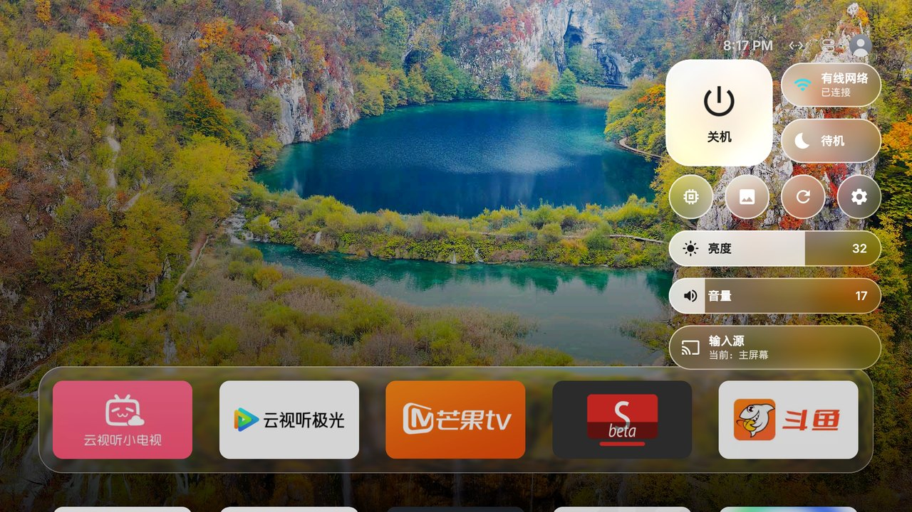

<div align="center">

# Lumen TV

**Una pantalla de inicio serena, inspirada en tvOS, para Android TV y Google TV.**

Dock de Liquid Glass · Widgets de tiempo y Top 10 · Centro de control · Salvapantallas con marco de fotos

[](https://github.com/luumlabs/lumen-tv/releases/latest)
[](https://github.com/luumlabs/lumen-tv/actions/workflows/android.yml)
[](#requisitos)
[](LICENSE)

[Descargar](https://github.com/luumlabs/lumen-tv/releases/latest) ·
[Instalar](#instalación) ·
[Compatibilidad](#compatibilidad) ·
[Notas de versión](https://github.com/luumlabs/lumen-tv/releases) ·
[English](README.md)

</div>


## Qué es

Lumen TV sustituye la pantalla de inicio de un Android TV por una inspirada en Apple TV: tus apps en
un dock de vidrio, el contenido de la app seleccionada encima y los controles de cada día a una
pulsación. No tiene anuncios, ni rastreo, ni cuentas, y funciona en hardware modesto: cada efecto
tiene una versión más ligera que se elige sola en los televisores de gama baja.

La interfaz está en inglés. Lumen TV es un fork independiente de
[Tigris](https://github.com/lesnolie/Tigris), de lesnolie. Consulta los [créditos](#créditos).

## Funciones

**Pantalla de inicio**

- Dock de Liquid Glass con las apps que más usas; el resto de la cuadrícula asoma debajo.
- Enfoque al estilo tvOS: la app seleccionada se eleva con un resorte, se inclina hacia donde te
  mueves, desplaza sus capas en profundidad y capta un reflejo. En reposo flota suavemente, como
  bajo el pulgar en el Siri Remote.
- El fondo toma los colores de la app enfocada, y el vidrio del dock los refracta.
- Carpetas, apps ocultas, orden manual o por uso reciente, y entradas HDMI como iconos.
- Contenido en el Top Shelf para las apps compatibles.

**Widgets**

- **Tiempo**: temperatura, estado del cielo y las próximas seis horas; con OK, el pronóstico de seis
  días. Datos de [Open-Meteo](https://open-meteo.com).
- **Top 10**: las películas y series más populares de la semana en tu país, y las mejor valoradas,
  con puntuaciones de IMDb, Rotten Tomatoes, TMDB y JustWatch, el reparto y dónde verlas. Se
  recorren a pantalla completa y abren directamente la app de streaming. Datos de
  [JustWatch](https://www.justwatch.com).

**Centro de control** (tecla Atrás en la pantalla de inicio)

- Apagar, reposo, reiniciar, volumen, fuente de entrada, red y liberación de memoria.
- Brillo de imagen en televisores Sony BRAVIA y Xiaomi.

**Salvapantallas y fondos**

- Salvapantallas de marco de fotos con tus fondos o con las películas aéreas de Apple TV.
- Fondos de Bing, colecciones seleccionadas, degradados o tus propias fotos, que subes desde el
  móvil escaneando un código QR.

**Mantenimiento**

- Actualizaciones integradas, firmadas y verificadas antes de instalarse.
- Eliminación y restauración de apps preinstaladas.
- Guardián de la pantalla de inicio para firmwares que imponen su propio launcher (Xiaomi, TCL y
  otros).

| Top Shelf | Todas las apps |
|---|---|
|  |  |
| **Centro de control** | **Marco de fotos** |
|  |  |

## Requisitos

- Un Android TV o Google TV con **Android 9 (API 28) o posterior**.
- Un ordenador con [`adb`](https://developer.android.com/tools/releases/platform-tools) en la misma
  red que el televisor, para la instalación.
- La depuración por red (ADB) activada en el televisor. Suele estar en *Ajustes → Preferencias del
  dispositivo → Información*: pulsa *Compilación* siete veces y activa *Depuración USB* o
  *Depuración por red* en *Opciones para desarrolladores*.

## Instalación

### Qué APK usar

Cada versión publica dos paquetes y un archivo de sumas de verificación.

| Paquete | Úsalo en |
|---|---|
| `Lumen-vX.Y.Z.apk` (estándar) | La mayoría de televisores. Se declara pantalla de inicio. |
| `Lumen-guard-vX.Y.Z.apk` (guard) | Firmware chino de TCL y FFalcon, que rechaza los APK de pantalla de inicio de terceros. Se abre como app y el guardián la mantiene al frente. |

### Script de instalación

El script se conecta al televisor, descarga la última versión, comprueba su SHA-256, la instala, la
convierte en pantalla de inicio y guarda una copia del launcher original para poder restaurarlo.

```sh
curl -fsSL -o install.sh https://raw.githubusercontent.com/luumlabs/lumen-tv/main/install.sh
TV=192.168.1.20 bash install.sh               # versión estándar
TV=192.168.1.20 bash install.sh -s guard      # versión guard
```

La primera vez que el ordenador se conecta, el televisor pregunta *¿Permitir depuración USB?*.
Marca *Permitir siempre* y elige *Permitir*.

### Instalación manual

```sh
adb connect 192.168.1.20:5555
adb install -r Lumen-v3.4.0.apk
adb shell cmd package set-home-activity com.luumlabs.lumen/.HomeActivity
adb shell input keyevent KEYCODE_HOME
```

En los firmwares que reservan la tecla Inicio para su propio launcher, concede los permisos que
necesita el guardián y actívalo:

```sh
P=com.luumlabs.lumen
adb shell pm grant $P android.permission.WRITE_SECURE_SETTINGS
adb shell cmd notification allow_listener $P/$P.RevivalListener
adb shell appops set $P SYSTEM_ALERT_WINDOW allow
adb shell am broadcast -a com.luumlabs.lumen.CONFIG -n $P/.ConfigReceiver --ez guard true
```

> No desactives el launcher de fábrica en televisores Xiaomi o Redmi (`com.mitv.tvhome`): su
> pantalla de respaldo rechaza los launchers de terceros y el televisor arrancaría en negro. Usa el
> guardián.

En el primer arranque, Lumen pide una vez acceso de depuración local, necesario para apagar, el
reposo y la limpieza profunda de memoria. Cuando el televisor muestre *¿Permitir depuración?*, marca
*Permitir siempre* y elige *Permitir*.

### Actualizar

Lumen busca versiones nuevas en segundo plano. En *Settings → Software Updates* puedes actualizar a
mano o activar las actualizaciones automáticas. Los paquetes se verifican con el certificado de
firma de las versiones antes de instalarse.

### Restaurar la pantalla de inicio original

```sh
TV=192.168.1.20 bash install.sh restore              # mantiene Lumen instalado
TV=192.168.1.20 bash install.sh restore --uninstall  # y además lo desinstala
```

Ejecútalo desde el ordenador con el que instalaste, que guarda la copia del launcher.

## Configuración

Todo está en el televisor, en *Settings* (el engranaje del Centro de control, o el avatar de la
esquina superior derecha). Las mismas opciones se pueden fijar desde un ordenador:

```sh
adb shell am broadcast -a com.luumlabs.lumen.CONFIG -n com.luumlabs.lumen/.ConfigReceiver \
  --es weather_city "Madrid" --es weather_unit c --es charts_country ES --ez clock_24 true
```

| Opción | Valores |
|---|---|
| `weather`, `charts` | `true` / `false`: mostrar los widgets |
| `weather_unit` | `auto`, `c`, `f` |
| `weather_city` | nombre de una ciudad; vacío para ubicar el televisor por su IP |
| `charts_country` | código de país de dos letras; vacío para automático |
| `app_tint` | `true` / `false`: el color del fondo sigue a la app enfocada |
| `clock_style` | `corner`, `large`, `off` |
| `clock_24` | `true` / `false` |
| `focus_style` | `auto`, `tvos`, `simple` |
| `cc_style` | `auto`, `glass`, `panel` |
| `background` | `daily`, `scenery`, `fresh`, `anime`, `art`, `mine`, `custom`, o un degradado: `green`, `blue`, `purple`, `orange`, `graphite` |
| `intro` | `off`, `boot`, `wake` |
| `guard`, `keep_adb` | `true` / `false` |

La respuesta muestra la configuración resultante.

## Compatibilidad

Lumen funciona en cualquier Android TV que cumpla los requisitos. Los controles propios de cada
televisor (brillo, salida de volumen, entradas HDMI, ajustes del sistema) usan un adaptador por
marca:

| Marca | Soporte |
|---|---|
| Sony BRAVIA | Brillo, volumen y entradas mediante la API de control IP de BRAVIA, con alternativa Android. |
| Xiaomi / Redmi (firmware chino) | Retroiluminación, entradas mediante el reproductor de Xiaomi, ajustes del fabricante; guardián y *Keep ADB on*. |
| TCL / FFalcon (firmware chino) | Versión guard, entradas mediante el selector de LiveTV, ajustes del fabricante. Sin control de brillo. |
| Skyworth / Coocaa | Entradas mediante el selector del launcher. Aún sin probar en hardware real. |
| Otras marcas | Controles estándar de Android TV. |

### Informes de la comunidad

Estas filas las envían los usuarios y **no están verificadas** por los mantenedores. Que se instale
no significa que todas las funciones vayan en ese televisor.

<!-- TV_COMPATIBILITY_AUTO_START -->
Todavía no hay informes de la comunidad. [Envía un informe](https://github.com/luumlabs/lumen-tv/issues/new/choose).
<!-- TV_COMPATIBILITY_AUTO_END -->

Para añadir tu televisor, [abre un informe de compatibilidad](https://github.com/luumlabs/lumen-tv/issues/new/choose).
Un workflow convierte los informes completos en un pull request para revisión.

## Privacidad

Lumen no tiene analíticas ni cuentas. Solo se conecta a internet para las funciones que usas:

| Función | Servicio |
|---|---|
| Fondos | La fuente elegida: Bing, colecciones de imágenes o tus propios enlaces |
| Widget del tiempo | Open-Meteo; la ubicación aproximada del televisor, de get.geojs.io, ipwho.is o ipapi.co, salvo que fijes una ciudad |
| Widget Top 10 | JustWatch |
| Top Shelf | La API web pública de la app compatible |
| Salvapantallas aéreo | Los servidores de películas aéreas de Apple |
| Actualizaciones | GitHub Releases |

Ambos widgets se pueden desactivar en *Settings → Widgets*.

## Compilar desde el código

Requisitos: JDK 17 y el Android SDK con `platforms;android-36` y `build-tools;36.0.0`. Indica la
ruta del SDK en `sdk.dir`, dentro de `local.properties`.

```sh
./gradlew testStandardDebugUnitTest testGuardDebugUnitTest   # tests unitarios
./gradlew assembleStandardRelease assembleGuardRelease      # los dos APK
```

Los APK quedan en `app/build/outputs/apk/{standard,guard}/release/`. Las compilaciones locales se
firman con tu clave de depuración, así que no pueden actualizar una versión publicada ya instalada.

Las versiones las compila y firma [GitHub Actions](.github/workflows/release.yml) al subir una
etiqueta `v*`; las notas salen de [`docs/releases`](docs/releases).

## Créditos

Lumen TV se basa en [Tigris](https://github.com/lesnolie/Tigris), de
[lesnolie](https://github.com/lesnolie), publicado con licencia MIT. El diseño original, la
arquitectura y la mayor parte del código son suyos; Lumen TV añade la interfaz en inglés, el cambio
de marca, los widgets, el rediseño y otros cambios. Dale una estrella al proyecto original.

Los componentes y fuentes de datos de terceros figuran en
[THIRD_PARTY_NOTICES.md](THIRD_PARTY_NOTICES.md).

## Licencia

[MIT](LICENSE). Se conserva el aviso de copyright original de Tigris, como exige la licencia;
consulta [NOTICE](NOTICE).

Apple TV, tvOS y Siri Remote son marcas de Apple Inc. IMDb, Rotten Tomatoes, TMDB, JustWatch y los
servicios de streaming que aparecen en la app son marcas de sus respectivos propietarios. Lumen TV
no está afiliado a ninguno de ellos, ni cuenta con su respaldo o patrocinio.
